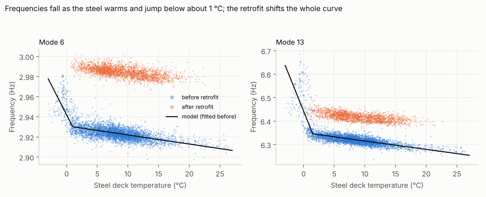
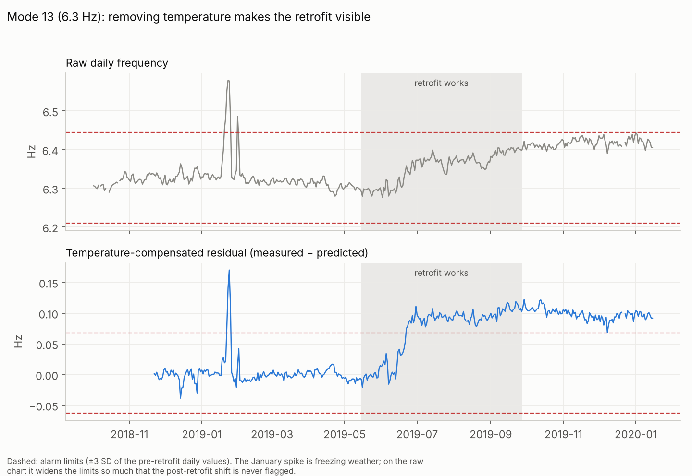
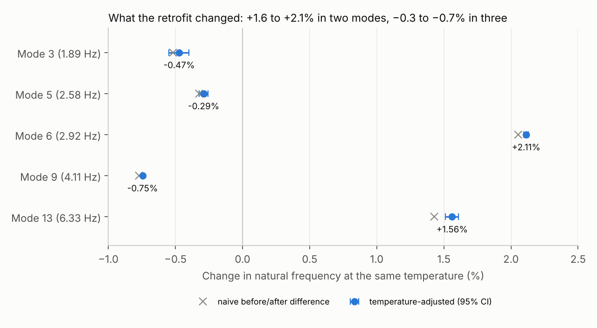

# Separating temperature from structural change on a real railway bridge (KW51)

**Result:** on 15 months of measured data from the KW51 steel railway bridge in Leuven, Belgium, a temperature model learned only from the pre-retrofit period removes most of the seasonal swing in the bridge's natural frequencies. With temperature removed, the effect of the 2019 strengthening works becomes measurable at a fixed temperature: **+2.11% for mode 6 and +1.56% for mode 13, and −0.29% to −0.75% for modes 3, 5 and 9** (95% intervals within ±0.01–0.08 percentage points). On a simple alarm chart, the compensation **roughly halves the alarm band** for modes 6, 9 and 13. For mode 13 it turns a chart that **never flags** the post-retrofit change into one that flags **98% of post-retrofit days**.

Data: K. Maes and G. Lombaert, *Monitoring railway bridge KW51 before, during, and after retrofitting*, ASCE Journal of Bridge Engineering 26(3), 2021, [doi:10.1061/(ASCE)BE.1943-5592.0001668](https://ascelibrary.com/doi/10.1061/%28ASCE%29BE.1943-5592.0001668); dataset [doi:10.5281/zenodo.3745914](https://zenodo.org/record/3745914). This repository uses only the `trackedmodes` file (natural frequencies and environmental data, hourly). The data are not redistributed here; see *Reproduce*.

## The problem

KW51 is a steel bowstring arch railway bridge on the line between Leuven and Brussels. KU Leuven monitored it from October 2018 to January 2020. During monitoring, damage was found at the connections between the diagonals and the deck and arches, and the bridge was strengthened (works from **15 May 2019**; the "after" period starts **27 September 2019**).

A change in stiffness shows up as a change in natural frequency, which is the basis of vibration-based structural health monitoring. But temperature moves the frequencies too: steel softens as it warms, and when the bridge freezes, the frequencies jump. These environmental swings can be as large as the changes caused by damage or repair. Before anyone can say what a repair did, or whether damage is developing, temperature has to be separated out.

## Approach

1. **Data.** Hourly natural frequencies of 14 tracked modes and 11 environmental channels. I use the five modes tracked at least 80% of the time in every period (modes 3, 5, 6, 9 and 13, from 1.9 to 6.3 Hz), and the steel temperature measured on the deck (`tBD31A`).
2. **A model of normal behaviour, learned before the retrofit only.** For each mode: frequency = a + b·T + c·max(0, T₀ − T). The first two terms are the usual linear softening with temperature. The third captures the extra stiffening below a knot T₀ (freezing). The model and T₀ were chosen by **blocked cross-validation on the pre-retrofit months** (each whole month held out in turn), so nothing after the retrofit influenced the choice. The freezing term was selected for all five modes (T₀ = 1–1.5 °C) and cut the cross-validated error by up to a third (mode 13: 0.038 → 0.026 Hz).
3. **Residuals.** Residual = measured − predicted frequency. Pre-retrofit residuals are cross-validated; during and after the retrofit, the model fitted on the full pre-retrofit period is applied unchanged.
4. **Alarm chart.** Daily mean residuals, with limits at ±3 standard deviations of the pre-retrofit days, compared with the same chart on the raw frequencies.
5. **Retrofit effect.** The mean post-retrofit residual is the change in frequency at the same temperature. Its 95% interval comes from a weekly block bootstrap, because consecutive hours are correlated. It is compared with the naive before/after difference, which ignores temperature.

## Results



**Temperature.** Above about 1 °C, frequencies fall slowly as the steel warms (mode 13: −0.06% per °C). Below it, they rise sharply: in the January 2019 cold spell, mode 13 rose by about 4%. After the retrofit, the whole temperature curve shifts.



**Alarm charts** (226 pre-retrofit days with data):

| Mode | Alarm band, raw (Hz) | Alarm band, compensated (Hz) | False-alarm days before, raw → compensated | First alarm after works began, raw → compensated | Post-retrofit days flagged, raw → compensated |
|---|---|---|---|---|---|
| 3 | ±0.020 | ±0.016 | 4 → 4 | 28 May → 24 May | 2% → 5% |
| 5 | ±0.015 | ±0.012 | 3 → 0 | 27 May → 15 May | 5% → 12% |
| 6 | ±0.020 | ±0.010 | 7 → 3 | 28 Jun → 2 Jun | 98% → 98% |
| 9 | ±0.011 | ±0.005 | 6 → 3 | 17 May → 15 May | 98% → 98% |
| 13 | ±0.117 | ±0.065 | 7 → 4 | never → 22 Jun | 0% → 98% |



**Retrofit effect at the same temperature:**

| Mode | Frequency before (Hz) | Temperature-adjusted change | 95% interval | Naive before/after difference |
|---|---|---|---|---|
| 3 | 1.892 | −0.47% | −0.55 to −0.40% | −0.52% |
| 5 | 2.580 | −0.29% | −0.32 to −0.26% | −0.32% |
| 6 | 2.925 | **+2.11%** | +2.10 to +2.13% | +2.05% |
| 9 | 4.109 | −0.75% | −0.75 to −0.74% | −0.77% |
| 13 | 6.327 | **+1.56%** | +1.51 to +1.61% | +1.43% |

**Why adjust, if the naive numbers look similar?** Over the full periods, the average temperatures before and after the retrofit happened to be close (8.1 and 9.1 °C), so the naive comparison is only slightly off. It goes wrong as soon as the comparison windows fall in different seasons. Comparing the winter before (Dec–Feb, 5.8 °C) with the six weeks after the works (12.9 °C), the naive estimate for mode 13 drops to +1.10%, while the adjusted estimate stays at +1.64%. Across three different comparison windows, the adjusted mode 13 effect stays within +1.56 to +1.68%; the naive one ranges from +1.10 to +1.65% (`results/window_sensitivity.csv`).

## What the results mean

- **Temperature compensation is what makes monitoring usable.** On raw frequencies, normal winter behaviour sets the alarm limits so wide that real changes can pass unnoticed, as mode 13 shows. Learning normal behaviour first, then watching what is left over, roughly halves the alarm band and makes the retrofit stand out.
- **The retrofit changed different modes in different directions.** Two modes stiffened by 1.6–2.1%, and three lost 0.3–0.75%. Strengthening both stiffens connections and adds steel, and each mode is sensitive to these in different proportions. The analysis measures the net change in each mode, not its cause; attributing it would need the bridge's finite element model.
- **Removing a confounder gives an effect estimate that does not depend on when you look.** The temperature-adjusted effect is stable across comparison windows; the naive one is not. This is a simple case of estimating an intervention's effect in the presence of a confounding variable.

## Limitations (found, not hidden)

- **Freezing is only partly captured.** A single knot cannot follow the cold spell of January 2019, when the bridge stayed stiff for several days as the temperature rose again (possibly because frozen components lag behind the steel temperature). The remaining spike causes most of the 3–4 false-alarm days on the compensated chart. A model with memory (for example, a lagged or hysteretic freezing term) is the natural next step.
- **Summer temperatures during the works (up to 38 °C) exceed the pre-retrofit range (up to 26 °C),** so residuals during the works partly rely on extrapolation. The retrofit effect is measured on the after period (0.6–22.7 °C), which is inside the training range.
- **The confidence intervals cover measurement noise, not model error.** For the noisier modes 3 and 5, the adjusted estimate moves by up to 0.18 percentage points between comparison windows, more than the bootstrap interval suggests.
- **One temperature sensor and five modes.** Other environmental channels (humidity, solar radiation, wind) and the other nine modes were not used.
- **Not a new result for this bridge.** KW51 is an established benchmark, and temperature effects and retrofit detection on it have been studied by its authors and others. This project reproduces that kind of analysis independently and adds the temperature-adjusted, per-mode effect sizes with uncertainty.

## Reproduce

1. Download `trackedmodes.zip` from [Zenodo record 3745914](https://zenodo.org/record/3745914) (about 13 MB; the other files are raw recordings and are not needed) and place `trackedmodes.mat` in `data/`.
2. Run from the repository root (a few seconds):

```
pip install numpy scipy pandas matplotlib
python src/analysis.py        # temperature models, residuals, retrofit effect, window sensitivity
python src/control_chart.py   # raw vs compensated alarm charts
python src/figures.py
```

| File | Purpose |
|---|---|
| `src/load.py` | Reads `trackedmodes.mat`, converts timestamps, labels the before / during / after periods |
| `src/analysis.py` | Model choice by blocked cross-validation, residuals, retrofit effect with block bootstrap |
| `src/control_chart.py` | Daily alarm charts on raw frequencies and residuals |
| `src/figures.py` | Figures 1–3 |

## Author

Richard Olanite · Berm Engineering and Consulting Ltd · [github.com/thatboypage](https://github.com/thatboypage)
